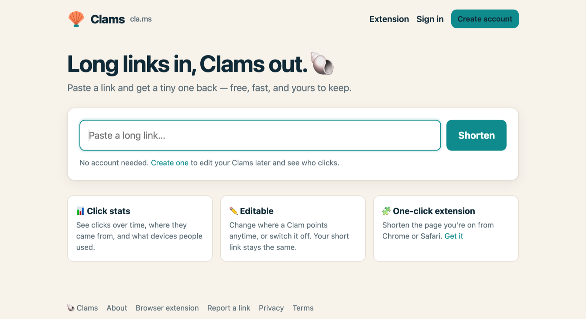
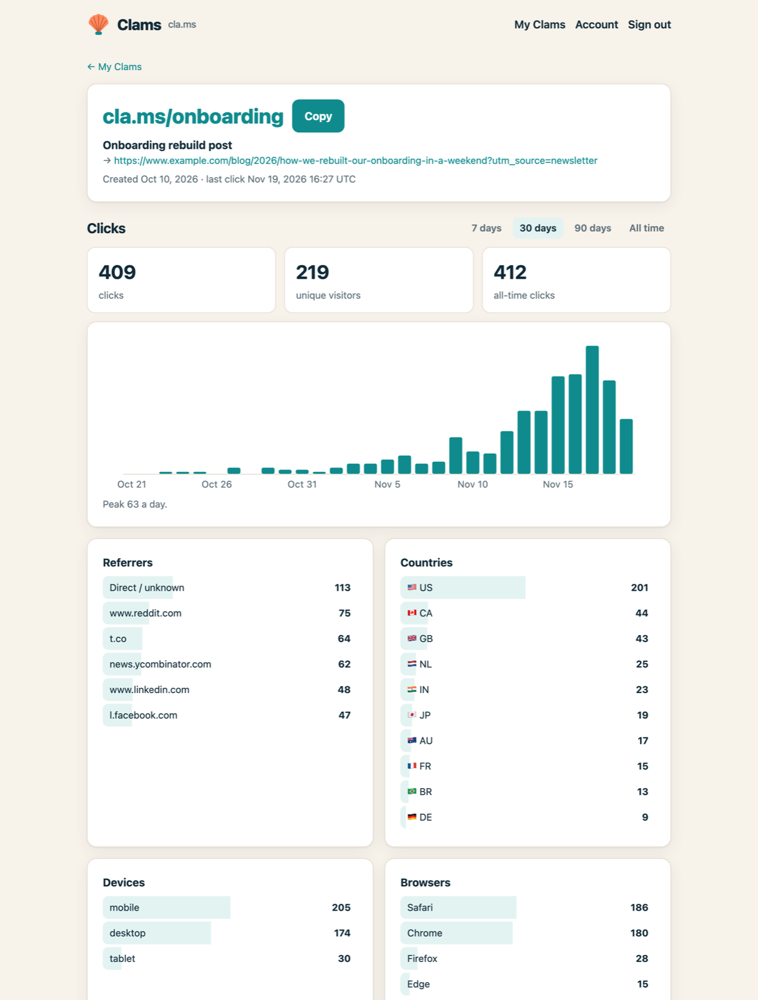
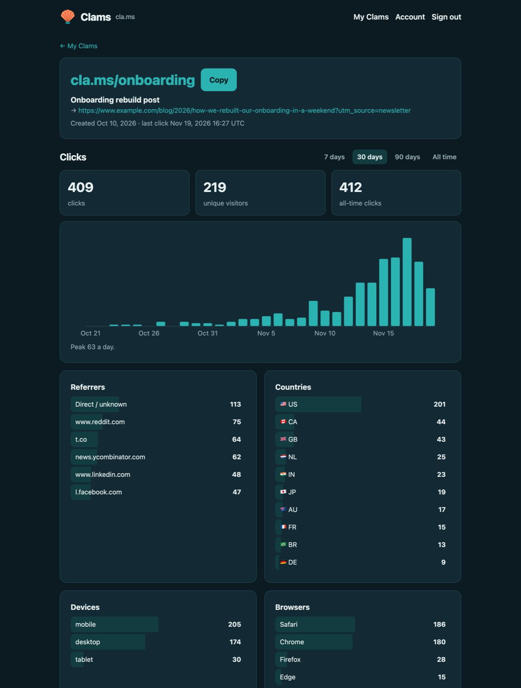
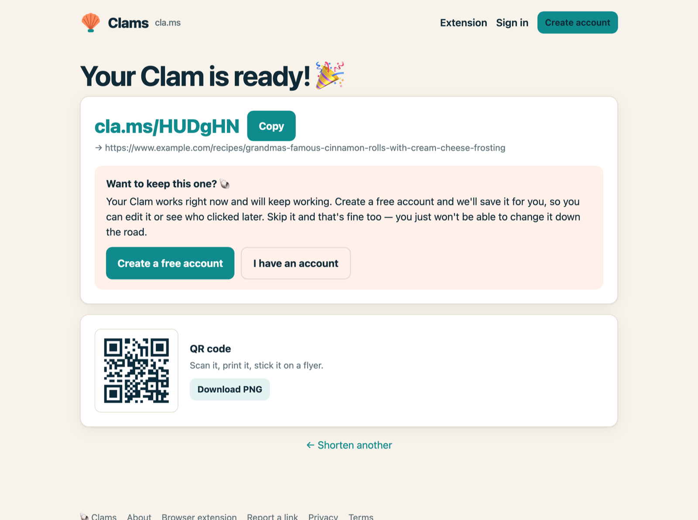
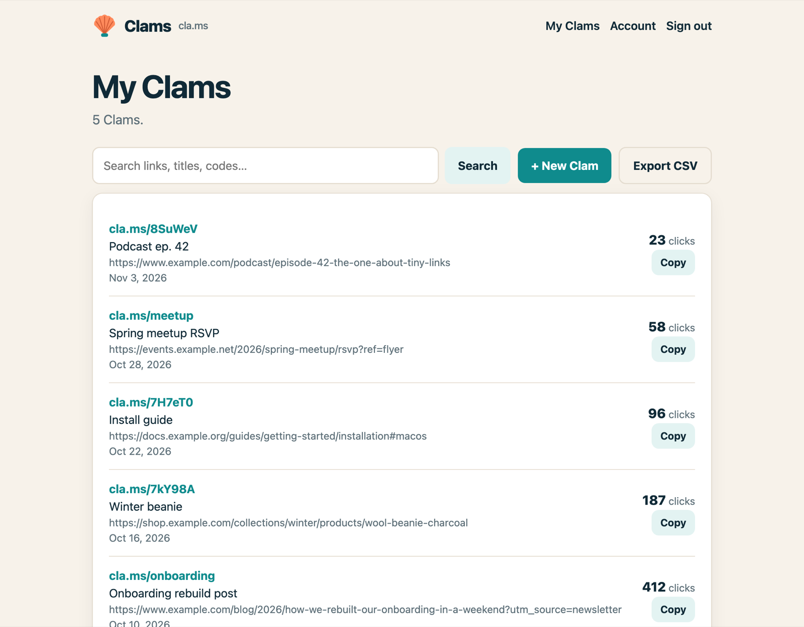
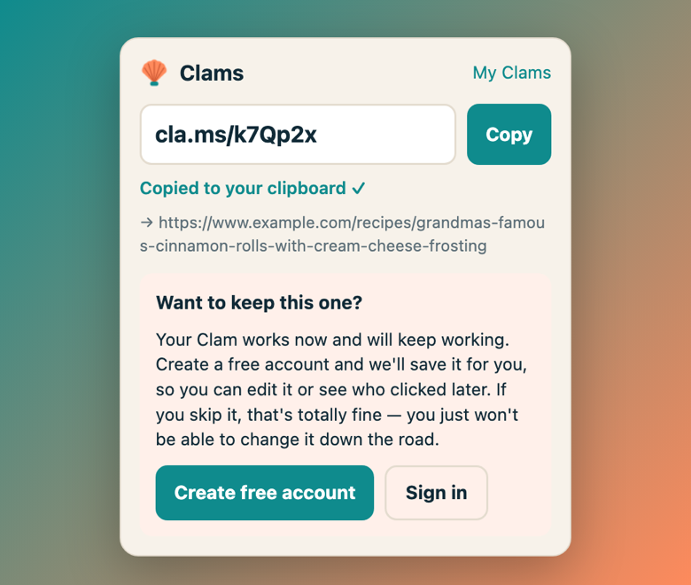

<p align="center">
  
</p>

<h1 align="center">Clams</h1>

<p align="center">
  <b>A small, friendly URL shortener.</b><br>
  Paste a long link, get a tiny one back. The short links are called <i>Clams</i> — because they live at <a href="https://cla.ms">cla.ms</a>.
</p>

<p align="center">
  <a href="https://cla.ms"><b>cla.ms</b></a> ·
  <a href="#features">Features</a> ·
  <a href="#browser-extension">Extension</a> ·
  <a href="#api">API</a> ·
  <a href="#run-it-yourself">Run it yourself</a>
</p>

<p align="center">
  
  
  
  
</p>

<p align="center">
  
</p>

---

## Why another shortener?

The big shorteners keep adding paywalls, interstitial pages and expiring links. Clams does the obvious things
well and stops there:

- **No account needed.** Shorten a link and go. Make a free account if you want to edit it or see stats later.
- **No ads, no interstitials, no expiry.** A Clam redirects straight to its destination, forever.
- **Private by design.** Click stats without storing anyone's IP address.
- **Lightweight.** Server-rendered pages, one small stylesheet, a few lines of JavaScript. No build step.

## Features

<table>
<tr>
<td width="50%" valign="top">

**Shortening**
- 6-character, case-sensitive codes: `cla.ms/aB3xY9` (62⁶ ≈ 56.8 billion of them)
- Custom names for signed-in users: `cla.ms/spring-sale`
- Shortening the same link twice gives you back the Clam you already have
- QR code for every Clam (SVG and PNG download)
- Add `+` to any Clam (`cla.ms/aB3xY9+`) to see where it goes before you click

</td>
<td width="50%" valign="top">

**Your Clams**
- Change where a Clam points, any time
- Turn a Clam off and back on, or delete it (deleted codes are never handed out again)
- Search, paging and CSV export
- Anonymous Clams follow you: sign up and the ones you made in that browser (or extension) move into your account

</td>
</tr>
<tr>
<td valign="top">

**Click stats**
- Clicks per day over 7, 30 or 90 days, or all time
- Unique visitors, referrers, countries, devices, browsers and operating systems
- Link-preview bots (Slack, iMessage, X, Facebook…) are recorded but not counted

</td>
<td valign="top">

**Accounts & safety**
- Email and password, Sign in with Google, Sign in with Apple
- Report-a-link form and an admin page that can turn off Clams or block whole domains
- Optional Google Safe Browsing check on every new link
- Rate limits for anonymous shortening and sign-in attempts

</td>
</tr>
</table>

<p align="center">
  
  
</p>

<p align="center">
  
  
</p>

## Browser extension



Click the 🐚 in your toolbar (or press <kbd>Alt</kbd>+<kbd>Shift</kbd>+<kbd>C</kbd>) and the page you're on becomes a
Clam, already copied to your clipboard.

- **Signed out:** your Clam works right away, and a short, friendly note explains that an account lets you edit it
  and see who clicked later.
- **Signed in:** Clams are saved to your account, with a link straight to their stats. Connecting the extension also
  moves the Clams you made while signed out into your account.

One Manifest V3 extension in [`extension/`](extension) serves every browser:

| Browser | How to install |
|---|---|
| Chrome, Edge, Brave, Arc | Download [`clams-extension.zip`](https://cla.ms/static/clams-extension.zip), unzip it, open `chrome://extensions`, turn on **Developer mode**, then **Load unpacked**. |
| Safari (Mac, iPhone, iPad) | Open [`safari/Clams/Clams.xcodeproj`](safari/Clams) in Xcode, set your signing team, and run the **Clams (macOS)** or **Clams (iOS)** scheme. Then turn the extension on in Safari's settings. |

The extension asks for as little as possible: the current tab's address and title (only when you click it), storage
for its sign-in token, and access to `cla.ms`. It never reads page contents or browsing history.

<br clear="right">

## API

Create a token on your account page, then:

```bash
curl -X POST https://cla.ms/api/v1/shorten \
  -H "Authorization: Bearer clm_your_token" \
  -H "Content-Type: application/json" \
  -d '{"url": "https://example.com/a/very/long/link", "title": "Optional title", "alias": "optional-name"}'
```

```json
{
  "code": "aB3xY9",
  "short_url": "https://cla.ms/aB3xY9",
  "url": "https://example.com/a/very/long/link",
  "clicks": 0,
  "saved": true,
  "stats_url": "https://cla.ms/links/aB3xY9"
}
```

| Endpoint | What it does |
|---|---|
| `POST /api/v1/shorten` | Make a Clam. Works without a token too (anonymous, rate-limited, returns a `claim_token`). |
| `GET /api/v1/links?page=1&q=` | List your Clams, newest first, 100 per page. |
| `GET /api/v1/links/{code}` | One Clam with its all-time stats. |
| `POST /api/v1/links/claim` | Move anonymous Clams into your account: `{"claim_tokens": ["clc_…"]}`. |
| `GET /api/v1/me` | Who the token belongs to. |

## Privacy

Clams counts clicks without tracking people:

- **No IP addresses are stored.** Unique visitors are counted with a keyed, one-way hash.
- Country comes from [DB-IP's free IP-to-Country Lite](https://db-ip.com) database, looked up on the server.
- No analytics scripts, no ad cookies, no third parties. The only cookies are sign-in, form protection, and the
  one that remembers anonymous Clams so you can save them later.

See the full [privacy page](https://cla.ms/privacy).

## How it's built

| Piece | Choice |
|---|---|
| Server | Python 3.12, [FastAPI](https://fastapi.tiangolo.com), Jinja2 templates, run by uvicorn behind Apache |
| Data | [SQLAlchemy Core](https://docs.sqlalchemy.org/en/20/core/) (no ORM) on MariaDB; SQLite for tests |
| Auth | Argon2 password hashes, database-backed sessions, OpenID Connect for Google and Apple |
| Extras | [segno](https://github.com/heuer/segno) for QR codes, [maxminddb](https://github.com/maxmind/MaxMind-DB-Reader-python) for country lookup |
| Front end | Hand-written CSS with light and dark themes, inline SVG charts, ~60 lines of JavaScript |

A few deliberate details:

- **Codes are case-sensitive in the database too.** MariaDB compares strings case-insensitively by default, so the
  `code` column uses a binary collation; `aB3xY9` and `ab3xy9` are different Clams.
- **Deleting a Clam never frees its code.** Old links in old emails can't be hijacked by a new owner.
- **Every form uses post/redirect/get** and a double-submit CSRF token, so a reloaded tab never re-submits anything.
- **The server never fetches the links people shorten,** so there is no server-side request forgery surface.

```
src/clams/
  app.py              app, security headers, error pages
  routes_public.py    home, shorten, the redirect, previews, QR codes
  routes_auth.py      sign up / in / out, password reset, Google + Apple
  routes_account.py   My Clams, stats, account settings, extension connect
  routes_api.py       JSON API
  routes_admin.py     reports, turning Clams off, blocked domains
  links.py users.py   the core logic
  templates/ static/  pages, CSS, JS
extension/            the Manifest V3 extension (Chrome + Safari)
safari/               Xcode wrapper app for the Safari extension
deploy/               example systemd unit and Apache vhost
```

## Run it yourself

```bash
git clone https://github.com/dbarkman/Clams.git && cd Clams
uv sync
uv run pytest -q
```

Run it locally on SQLite:

```bash
export CLAMS_DATABASE_URL=sqlite:///dev.db CLAMS_SECURE_COOKIES=0
uv run clams-admin migrate
uv run uvicorn clams.app:app --port 8123
```

For production, copy [`.env.example`](.env.example) to `.env`, point it at a MariaDB database, and run
`uv run clams-admin migrate`. [`deploy/`](deploy) has an example systemd unit and Apache reverse-proxy config.
Google, Apple, email (via [Resend](https://resend.com)) and Safe Browsing each switch on when their settings are
filled in; until then the site simply hides them. `scripts/update-geoip.sh` fetches the country database (run it
monthly), and `clams-admin grant you@example.com` makes an account an admin.

If you change the extension, run `scripts/build-extension.sh` to rebuild the downloadable zip.

---

<p align="center">Made with 🐚 by <a href="https://redmesastudios.com">Red Mesa Studios</a>.</p>
